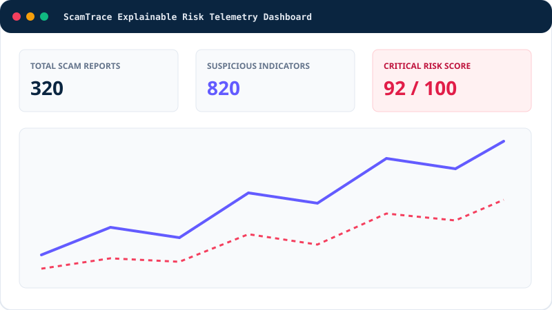

# ScamTrace – Explainable Digital Scam Investigation Platform



> **"Investigate Smarter. Detect Scams. Understand Every Signal."**  
> An explainable digital scam detection and forensic investigation platform inspired by Stripe Radar's enterprise risk telemetry.

---

## 1. Project Overview

**ScamTrace** is a full-stack cybersecurity and digital fraud investigation web application designed to help security analysts, financial fraud investigators, academic researchers, and everyday users identify suspicious digital activity and understand **WHY** an entity or message has been classified as potentially fraudulent.

Rather than acting as an opaque black-box classifier that outputs a binary *"Scam detected"* label, ScamTrace decomposes every evaluation into:
1. **Detected Suspicious Indicators** (URLs, domains, phone numbers, email addresses, UPI Virtual Payment Addresses, and transaction references).
2. **Triggered Detection Rules** from a 24-rule weighted heuristic catalog.
3. **Exact Point Contribution** of each factor toward the reproducible 0–100 Risk Score.
4. **Supporting Evidence** and matches within the 1,500+ record interconnected Threat Intelligence corpus.
5. **Recommended Out-of-Band Verification Steps**.
6. **Methodological Limitations** (distinguishing between a heuristic Risk Score and structural Confidence, and ensuring a high risk score is never presented as legal proof of criminal activity).

---

## 2. Features

- **Public Product Landing Page (`/`)**: Enterprise SaaS presentation introducing ScamTrace, its explainable scoring engine, four-step investigative workflow, architecture, and responsible-use principles.
- **Role-Based Authentication (`/login`, `/signup`)**: Secure registration and login using `bcryptjs` password hashing, HTTP-only signed JWT session cookies (`jose`), rate limiting, and server-enforced RBAC across three roles: **Administrator**, **Investigator**, and **Viewer**.
- **Stripe Radar–Inspired Overview Dashboard (`/app`)**: 6 live KPI cards, dataset integrity verification strip, Recharts time-series velocity charts, risk distribution breakdown, scam category comparisons, and 4 recent-activity panels with working time and category filters.
- **Explainable Scam Analysis Engine (`/app/analyze`)**: Supports **URL Analysis**, **Message Analysis**, **UPI Identifier Analysis**, **Email Analysis**, **Phone Number Analysis**, and **Transaction Reference Analysis** with static local parsing (never visits or executes untrusted URLs), mathematical score formula breakdown, one-click synthetic presets, and escalation to Scam Reports.
- **Scam Report Management (`/app/reports`)**: Server-side paginated, searchable, sortable, and filterable table of 320+ scam reports with full detail modals, triage status updates, case linking, archiving, and CSV export.
- **Investigation Case Management (`/app/investigations`)**: Master-detail forensic case management for 110+ cases (`NEW`, `UNDER_INVESTIGATION`, `PENDING_REVIEW`, `RESOLVED`, `CLOSED`), investigator assignment, analyst notes, linked artifacts, CSV export, and printable PDF report generation.
- **Threat Intelligence (`/app/threat-intelligence`)**: Tracks 16 scam archetypes, emerging weekly growth trends, repeated high-association indicators, 160 suspicious message samples, and 160 synthetic transaction events.
- **Indicator Database (`/app/indicators`)**: Searchable repository of 820+ indicators across URLs, Domains, Phones, Emails, and UPI handles with detailed *"Why Suspicious"* inspection modals.
- **Entity Relationship Network (`/app/entity-network`)**: Interactive `@xyflow/react` graph visualizing 260+ stored database relationships (`CONTAINS_INDICATOR`, `INVESTIGATED_IN`, `CO_OCCURS_IN_MESSAGE`, `SETTLES_TO_HANDLE`) with node selection, connected-cluster highlighting, search, and risk color coding.
- **Detection Rule Management (`/app/rules`)**: Manage 24 explainable detection rules, toggle active states, calibrate permitted score weights (5–45 pts, Administrator-only), and run live rule simulations in the interactive test bench.
- **Forensic Evidence Vault (`/app/evidence`)**: Centralized chain-of-custody artifact management with MIME allowlisting, 5 MB file size validation, automatic SHA-256 cryptographic digest computation, and custody timeline.
- **Risk Analytics (`/app/analytics`)**: Executive analytical charts with interactive date-range and category filters.
- **Alert & Notification Center (`/app/alerts`)**: Real-time alerts for critical analyses, case assignments, evidence updates, and rule modifications with read/unread management.
- **Audit Logs & Settings (`/app/audit-logs`, `/app/settings`)**: Immutable chronological audit trail of security events, personal workspace preferences, and Administrator RBAC user management.

---

## 3. Architecture

```
scamtrace/
├── prisma/
│   ├── schema.prisma                # Local zero-config relational schema (SQLite)
│   ├── schema.postgresql.prisma     # Production PostgreSQL schema (Docker / Cloud)
│   ├── migrations/                  # Relational SQL DDL migrations
│   └── seed.ts                      # Deterministic 2,321-record synthetic generator
├── public/
│   ├── images/                      # Vector dashboard preview assets
│   └── icons/                       # ScamTrace shield iconography
├── scripts/
│   └── verify-dataset.ts            # CLI verifier enforcing >= 1,500 records
├── src/
│   ├── app/
│   │   ├── page.tsx                 # Public Landing Page
│   │   ├── login/page.tsx           # Role-Based Login + Demo Quick-Fill
│   │   ├── signup/page.tsx          # Validated Investigator Registration
│   │   ├── app/                     # Protected Investigator Workspace (13 Modules)
│   │   │   ├── page.tsx             # Overview Dashboard
│   │   │   ├── analyze/page.tsx     # Core Explainable Scam Analysis Engine
│   │   │   ├── reports/page.tsx     # Scam Report Management
│   │   │   ├── investigations/      # Investigation Case Dossiers
│   │   │   ├── threat-intelligence/ # Threat Intelligence & Samples
│   │   │   ├── indicators/          # Suspicious Indicator Database
│   │   │   ├── entity-network/      # Interactive React Flow Entity Graph
│   │   │   ├── rules/               # Explainable Detection Rules & Simulator
│   │   │   ├── analytics/           # Dedicated Risk Analytics
│   │   │   ├── alerts/              # Alert & Notification Center
│   │   │   ├── evidence/            # Forensic Evidence Vault
│   │   │   ├── audit-logs/          # Immutable Security Audit Trail
│   │   │   └── settings/            # Profile & Admin User/Role Governance
│   │   └── api/                     # Server-Side REST Route Handlers
│   ├── components/                  # AppShell, ScamTraceLogo, ToastProvider
│   ├── lib/                         # Prisma singleton, Auth/JWT/RBAC, Rate Limiter
│   ├── services/                    # Explainable Analysis Engine & 24 Default Rules
│   ├── types/                       # Strict TypeScript domain interfaces
│   └── middleware.ts                # Edge route protection for /app/*
├── tests/
│   └── scamtrace.test.ts            # 12-part Vitest automated test suite
├── .github/workflows/ci.yml         # GitHub Actions CI pipeline
├── docker-compose.yml               # PostgreSQL 16 + Next.js container orchestration
└── Dockerfile                       # Multi-stage production container build
```

---

## 4. Tech Stack

- **Frontend**: Next.js 14 (App Router), React 18, TypeScript (Strict Mode), Tailwind CSS, Lucide React Icons, Recharts, React Flow (`@xyflow/react`).
- **Backend**: Next.js Server Route Handlers, TypeScript, Zod Schema Validation, Endpoint Rate Limiting, Server-Side RBAC.
- **Database**: Prisma ORM (`@prisma/client` v5.22) with dual support for zero-config local SQLite (`prisma/schema.prisma`) and containerized PostgreSQL 16 (`prisma/schema.postgresql.prisma` + `docker-compose.yml`).
- **Authentication**: `bcryptjs` password hashing + `jose` HS256 signed HTTP-only session cookies.
- **Testing & Quality**: Vitest, TypeScript (`tsc --noEmit`), ESLint (`next lint`).

---

## 5. Database Design

ScamTrace implements 15 normalized relational models with primary keys, foreign keys, referential integrity (`onDelete: Cascade` / `SetNull`), and composite indexes:
1. `User`
2. `InvestigationCase`
3. `ScamReport`
4. `Indicator`
5. `MessageSample`
6. `TransactionEvent`
7. `Evidence`
8. `ThreatPattern`
9. `DetectionRule`
10. `AnalysisResult`
11. `DetectionFactor`
12. `EntityRelationship`
13. `CaseNote`
14. `Alert`
15. `AuditLog`

---

## 6. Installation

```bash
git clone <your-github-repo-url>
cd scamtrace
npm install
```

---

## 7. Environment Variables

Copy `.env.example` to `.env`:

```bash
cp .env.example .env
```

Default `.env` configuration:
```env
# Local zero-config relational database (or PostgreSQL connection string)
DATABASE_URL="file:./dev.db"
SESSION_SECRET="scamtrace-enterprise-session-secret-key-2026-dev-only"
NEXT_PUBLIC_APP_URL="http://localhost:3000"
NEXT_PUBLIC_ENVIRONMENT_LABEL="Demo Workspace"
RATE_LIMIT_LOGIN_MAX="20"
RATE_LIMIT_ANALYZE_MAX="50"
RATE_LIMIT_WINDOW_MS="60000"
MAX_EVIDENCE_SIZE_BYTES="5242880"
EVIDENCE_STORAGE_MODE="metadata-local"
```

---

## 8. Database Migration

Apply the relational database migrations and generate the Prisma client:

```bash
npm run db:generate
npm run db:migrate
```

---

## 9. Seeding the 1,500+ Records & Verification Result

Run the deterministic, idempotent seed script and verify the record counts:

```bash
npm run db:seed
npm run db:verify
```

### Verified Dataset Summary (`npm run db:verify` Output)

| Data Collection | Seeded Records | Minimum Required | Verification Status |
|---|---:|---:|---|
| **Scam reports (`ScamReport`)** | **320** | 300 | **PASS** |
| **Suspicious URL/domain indicators (`URL` + `DOMAIN`)** | **320** | 300 | **PASS** |
| **Suspicious phone indicators (`PHONE`)** | **210** | 200 | **PASS** |
| **Suspicious email indicators (`EMAIL`)** | **210** | 200 | **PASS** |
| **Suspicious message samples (`MessageSample`)** | **160** | 150 | **PASS** |
| **Synthetic transaction records (`TransactionEvent`)** | **160** | 150 | **PASS** |
| **Investigation cases (`InvestigationCase`)** | **110** | 100 | **PASS** |
| **Evidence artifacts (`Evidence`)** | **120** | 100 | **PASS** |
| **Mandatory 8-Collection Subtotal** | **1,610** | **1,500** | **PASS** |
| Additional UPI Indicators, Rules, Threat Patterns, Graph Edges, Analyses, Notes, Alerts, Audit Logs & Users | **711** | — | **PASS** |
| **GRAND TOTAL DATABASE RECORDS** | **2,321** | **1,500** | **PASS (Verified)** |

---

## 10. Demo Login Credentials

The `/login` page includes one-click quick-fill buttons for all three role-based demo accounts:

| Role | Email | Password | Permissions |
|---|---|---|---|
| **Administrator** | `admin@scamtrace.example` | `ScamTrace@Admin2026` | Full access: calibrate Detection Rules, manage User Roles, Cases, Reports, Evidence, Exports |
| **Investigator** | `investigator@scamtrace.example` | `ScamTrace@Investigator2026` | Run Analyses, create/edit Scam Reports & Cases, upload Evidence, export CSV/PDF reports |
| **Viewer** | `viewer@scamtrace.example` | `ScamTrace@Viewer2026` | Read-only audit access + sandboxed Scam Analysis execution |

---

## 11. Running Locally

Start the development server:

```bash
npm run dev
```

Open [http://localhost:3000](http://localhost:3000) in your browser.

---

## 12. Testing

Run the automated test suite, TypeScript type checker, ESLint, and dataset verification:

```bash
npm run typecheck
npm run lint
npm test
npm run db:verify
npm run build
```

---

## 13. Screenshots & Visual Tour

- **Public Homepage (`/`)**: Hero with interactive explainable risk card preview, 8 capability modules, 4-step workflow, tech stack, and responsible-use disclosure.
- **Overview Dashboard (`/app`)**: 6 Stripe Radar-style KPI cards, 1,500+ dataset verification strip, detection velocity area chart, risk distribution donut chart, and 4 live activity tables.
- **Explainable Scam Analyzer (`/app/analyze`)**: 6-channel analyzer displaying Risk Score vs. Heuristic Confidence, mathematical formula breakdown, triggered rule cards, and extracted indicators.
- **Entity Relationship Network (`/app/entity-network`)**: Interactive React Flow node-link graph with degree inspection and connected-cluster highlighting.

---

## 14. Deployment

### Option A: Docker & PostgreSQL 16
```bash
cp prisma/schema.postgresql.prisma prisma/schema.prisma
docker compose up --build -d
```

### Option B: Node.js Production Server
```bash
npm run build
npm start
```

---

## 15. Limitations and Responsible-Use Notes

1. **Investigative Assistance Tool Only**: ScamTrace is an academic and forensic decision-support system, not a legal authority or definitive fraud adjudication service. A high risk score indicates structural similarity to known scam patterns and is **not** standalone proof of criminal activity.
2. **Rule-Based Heuristic Demonstration**: Risk scores are computed using 24 deterministic weighted rules and a synthetic threat intelligence corpus, not live external WHOIS, DNS, or commercial reputation feeds.
3. **Static Untrusted Input Parsing**: Submitted URLs and messages are analyzed locally as inert text strings; ScamTrace never visits, opens, or executes untrusted links.
4. **100% Synthetic Dataset**: All 2,321 seeded records exclusively use reserved `.example`/`.test` domains, synthetic handles, and fictional identifiers.

